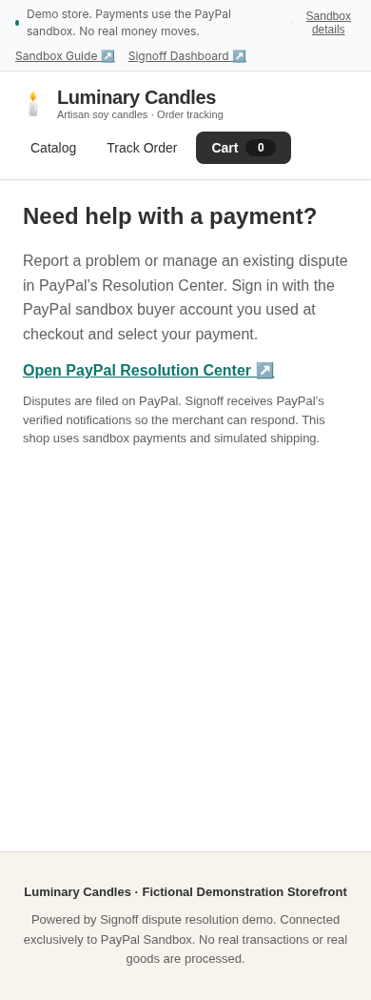

# Observed Render release — 2026-10-31

This is the deployed Render shop in desktop Chromium at a 390×844 viewport, **not a physical Android phone**. Its document width is 390px with no horizontal overflow. Public buyer dispute URLs provide PayPal Resolution Center guidance; there is no local dispute/reply/offer-acceptance form or direct-capture shortcut.

[Safe owner-session report](owner-session.json) records the actual deployed login/session/reload/CSRF/logout/denied-access result. Cookie values, passwords, credential hashes, CSRF values and authorization headers are excluded. The cookie is HttpOnly/Secure/SameSite=None and partitioned under the actual merchant site. Only the supplied managed-proxy CA SPKI was trusted for this execution environment; browser privacy was not disabled.

Live readiness observed a fresh worker heartbeat and an existing verified webhook receipt. PayPal and LLM states were **configured**, not a new successful provider call or validated live plan. This does not prove a fresh complete purchase → PayPal Resolution Center → webhook → model → gate → execution journey.

Application behavior was observed after main release e2fe052/c395bd6; the narrow-header follow-up was observed after fac224f. Workflow-only cleanup fix 1c772d7 does not change application behavior. Exact remote commit/workflow observations are in EXECUTION-LOG.md.

Final remote verification: main 1c772d7 [standard CI](https://github.com/AkinDiamonds/signoff-project/actions/runs/41233591393) and [full E2E](https://github.com/AkinDiamonds/signoff-project/actions/runs/41233591407) both completed successfully; 12 browser cases pass. This remote stub-based suite is distinct from the observed Render owner/buyer-boundary probe and from the still-pending real complete PayPal transaction journey.

Physical Android push, a newly recorded real sandbox purchase/dispute journey, automatic/manual shipment progression and the remaining T04–T17 scope are not claimed complete by this evidence.
